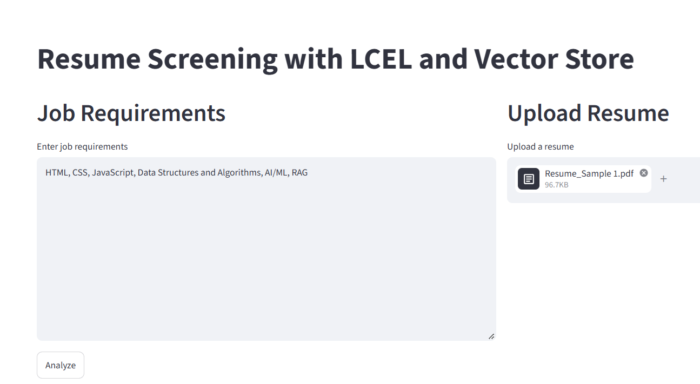
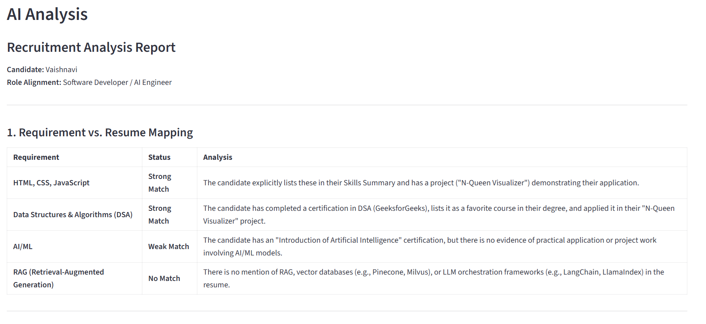
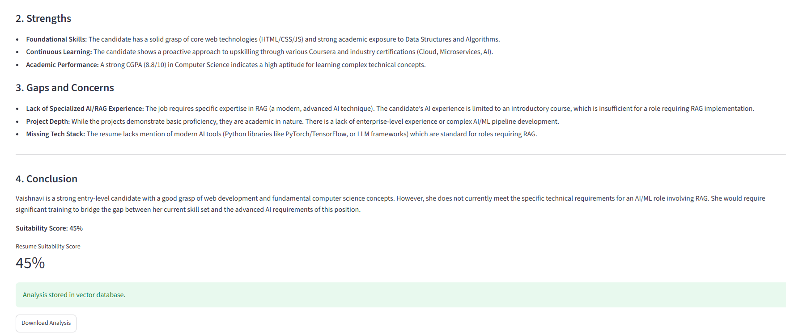

# Resume Screening App

A Streamlit application that compares an uploaded resume with job requirements using Google Gemini. It displays a structured match analysis and suitability score, lets you download the analysis, and stores analysis text in a local Chroma vector store.

## Features

- Accepts resumes in PDF, DOCX, and TXT formats.
- Compares the extracted resume text with job requirements using Gemini.
- Displays the analysis and, when returned in the expected format, a suitability score from 0–100%.
- Offers the analysis as a downloadable text file.
- Persists analysis chunks in `chroma_store/` using Google Generative AI embeddings.

## Requirements

- Python 3.10 or newer.
- A Google AI API key with access to the Gemini models used by the app.
- The dependencies listed in `requirements.txt`.

## Setup on Windows

Open PowerShell in the project directory and create and activate a virtual environment:

```powershell
py -m venv .venv
.\.venv\Scripts\Activate.ps1
```

Install the project dependencies:

```powershell
python -m pip install --upgrade pip
python -m pip install -r requirements.txt
```

Create a `.env` file in the project directory and add your API key:

```dotenv
GOOGLE_API_KEY=your_google_ai_api_key
```

Do not commit your `.env` file or share your API key.

## Run the app

With the virtual environment activated, run:

```powershell
streamlit run resume.py
```

Streamlit will print a local URL to open in your browser.

## Use

1. Enter the job requirements in the left-hand text area.
2. Upload a resume (`.pdf`, `.docx`, or `.txt`) in the right-hand panel.
3. Select **Analyze**.
4. Review the extracted resume text and AI analysis, then download the analysis if needed.

The analysis is stored locally in the `chroma_store/` directory. The app uses the resume text to request an analysis from Google Gemini; do not upload sensitive personal information unless you are permitted to share it with that service.

## Screenshots







## Project files

- `resume.py` — Streamlit application.
- `requirements.txt` — Python dependencies.
- `chroma_store/` — Persistent local Chroma database, created or reused at startup.
- `Resume_Sample*.pdf` — Sample resume files available in the project directory.
